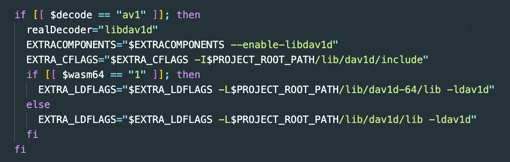
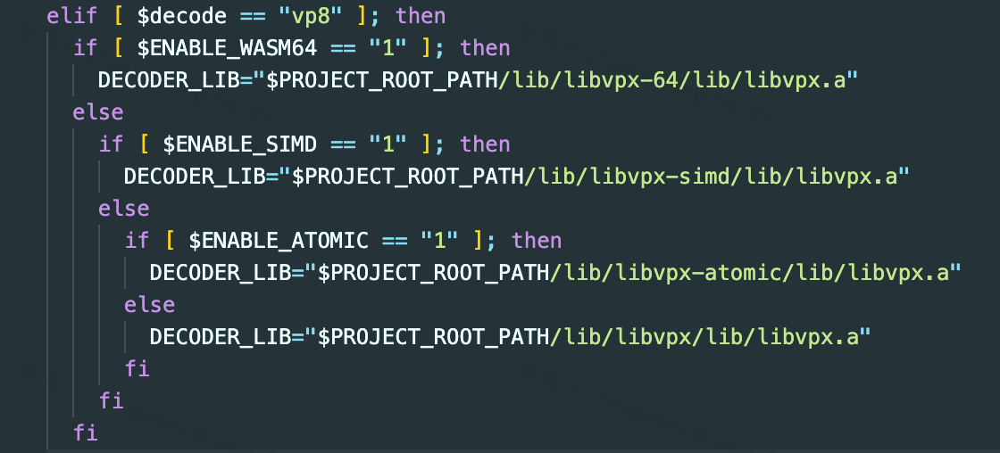

---
nav:
  title: 指南
  order: 2
group:
  title: 其他
order: 4
---

# 编译 Wasm 编解码器

目前 libmedia 编译了一些常见的音视频编解码器，若需要支持未支持的编码格式，可以按下面的步骤手动从 FFmpeg 中编译出来。

## 环境准备

编译系统推荐使用 MacOS 或者 Linux，Windows 使用 WSL 编译

1. 安装 emscripten 编译工具 emsdk，具体安装步骤按照[官网](https://emscripten.org/docs/getting_started/downloads.html#platform-notes-installation-instructions-sdk)

2. 根据你的编译系统安装 make 工具链，自行搜索如何安装和验证（如果你的系统上已经有了跳过此步骤）

3. 克隆 FFmpeg，使用 libmedia 定制的[仓库](https://github.com/zhaohappy/FFmpeg)，并切换到 ```libmedia7.0``` 分支

```shell
git clone https://github.com/zhaohappy/FFmpeg.git

cd FFmpeg

git checkout libmedia7.0
```

4. 克隆 libmedia 和子模块

```shell
git clone https://github.com/zhaohappy/libmedia.git --recursive
```

建议将 emsdk、FFmpeg、libmedia 放置到同一个目录下，否则编译时需要更改编译脚本中的 emsdk、FFmpeg 路径，更改位置搜索 FFMPEG_PATH 和 EMSDK_PATH。 编译脚本默认路径是和 libmedia 同级目录。

简单了解一下 FFmpeg 的编译参数，FFmpeg 中编解码器有两种，一种是 FFmpeg 本身自己实现的，这种只需要打开对应的 ```--enable-decoder=xxx``` 或 ```--enable-encoder=xxx``` 配置；另一种是集成的第三方库，比如 x264，x265，libdav1d 等。如果你需要编译的是集成第三方库的编解码器，可以参照编译脚本中 x264，x265，libdav1d 等的配置添加对应的配置脚本，并且首先将对应的第三方库编译成 wasm 指令集的库文件待用。

编译第三方库时如果该库使用了 pthread、atomic、semaphore 等功能，需要更改代码使用 cheap/include 下对应的头文件，一般可以使用宏定义替换来实现；编译第三方库的步骤取决于该库的构建系统；如果是 Make 可以参考 libmedia/build/build-x264-lib.sh 脚本；Meson 可以参考 libmedia/build/build-dav1d-lib.sh，生成的库文件放到 libmedia/lib 目录下。

## 编译 FFmpeg 中对应 codec 的 lib 文件

如果编译的是依赖第三方库的编解码器， FFmpeg 的 configure 脚本里面去掉对应的依赖检查命令，否则会报依赖找不到。比如下面图片显示的是去掉检查 libopenh264 的依赖检查。


去掉之后在编译命令中通过 --extra-cflags 添加 include 目录，通过 --extra-ldflags 添加 lib 目录。比如下面图片显示的是编译脚本 build-ffmpeg-decoder.sh 中编译依赖 dav1d 的 av1 解码器的配置。



```shell

# 进入到 libmedia 根目录
cd libmedia

# 找到你需要编译的解码器在 FFmpeg 编译脚本中开启的名字，比如 h264 为 'h264'，h265 为 'hevc'
# 使用找到的名字替换下面的命令中的 'aac' 

# 编译 aac 解码器 baseline 版本
./build/build-ffmpeg-decoder.sh aac 0 0 0
# 编译 aac 解码器 atomic 版本
./build/build-ffmpeg-decoder.sh aac 0 1 0
# 编译 aac 解码器 simd 版本
./build/build-ffmpeg-decoder.sh aac 1 1 0
# 编译 aac 解码器 64 版本
./build/build-ffmpeg-decoder.sh aac 1 1 1

# 编译 aac 编码器 baseline 版本
./build/build-ffmpeg-encoder.sh aac 0 0 0
# 编译 aac 编码器 atomic 版本
./build/build-ffmpeg-encoder.sh aac 0 1 0
# 编译 aac 编码器 simd 版本
./build/build-ffmpeg-encoder.sh aac 1 1 0
# 编译 aac 编码器 64 版本
./build/build-ffmpeg-encoder.sh aac 1 1 1
```

编译完成之后会在 libmedia/lib/decode 或者 libmedia/lib/encode 目录下生成对应的库文件

## 编译 codec 对应的 wasm 二进制文件

```shell

# 编译 aac 解码器 baseline 版本的二进制
./build/build-decoder.sh aac 0 0 0
# 编译 aac 解码器 atomic 版本的二进制
./build/build-decoder.sh aac 0 1 0
# 编译 aac 解码器 simd 版本的二进制
./build/build-decoder.sh aac 1 1 0
# 编译 aac 解码器 64 版本的二进制
./build/build-decoder.sh aac 1 1 1

# 编译 aac 编码器 baseline 版本的二进制
./build/build-encoder.sh aac 0 0 0
# 编译 aac 编码器 atomic 版本的二进制
./build/build-encoder.sh aac 0 1 0
# 编译 aac 编码器 simd 版本的二进制
./build/build-encoder.sh aac 1 1 0
# 编译 aac 编码器 64 版本的二进制
./build/build-encoder.sh aac 1 1 1

```

如果编译的编解码器是集成的第三方库，需要将上面编译好的第三方库 lib 包含到编译脚本中，可以参照 libmedia/build/build-decoder.sh 中 vp8 的配置或者 libmedia/build/build-encoder.sh 中的 x264 的配置。如下图显示



最终会在 dist/decode 或者 dist/encode 目录下面生成对应的 wasm 二进制文件。

## Typescript 更改

在 ```avutil/function/getWasmUrl.ts``` 文件和 ```site/docs/demo/utils.ts``` 文件中添加对新 Codec Wasm url 的支持。

如果某个 AVStream 的 CodecId 为 AV_CODEC_ID_NONE，表示解封装层不支持此 Codec，需要在 Format 中添加支持。

## 提交到仓库

建议将你添加的编解码器合并到 libmedia 仓库供大家一起使用，将 libmedia/lib 下新的 lib 文件，dist/decode 和 dist/encode 下新的 wasm 文件以及 libmedia/build 下的脚本的更改（除去 FFMPEG_PATH 和 EMSDK_PATH 的更改）提交 PR 到 libmedia 仓库。

## WMV / VC-1

WMV1、WMV2、WMV3 和 VC-1 共用 `wmv.wasm` 系列。自定义 `getWasm` 回调需要将
`AV_CODEC_ID_VC1` 也路由到对应的 WMV 组件。ASF 解封装不依赖浏览器原生 WMV 支持。

更新播放器时同时部署本次构建的四种 `dist/decode/wmv*.wasm`，并使用 `wasmBaseUrl`
指向该目录的父目录，例如 `/dist`；未包含 VC-1 的旧版 CDN 或缓存组件不能用于 VC-1 播放。
如配置了 `getWasm`，需直接更新其返回地址，`wasmBaseUrl` 不会覆盖该回调。
音频仍使用 `wma*.wasm`，部署示例见[播放器文档](./player.md)。
构建使用定制 FFmpeg `libmedia7.0`，验证工具链为 Emscripten 3.1.73。

```bash
for variant in "0 0 0" "0 1 0" "1 1 0" "1 1 1"; do
  ./build/build-ffmpeg-decoder.sh wmv $variant
  ./build/build-decoder.sh wmv $variant
done
```

上述参数顺序为 SIMD、atomic、wasm64，分别生成 baseline、atomic、SIMD 和 64 位版本。
两个脚本依次更新 `lib/decode/wmv*/libavcodec.a` 和 `dist/decode/wmv*.wasm`，两类产物需要配套交付。
64 位版本须同时使用 `WASM_64` 播放器构建；不能将它加载到 32 位播放器中。
